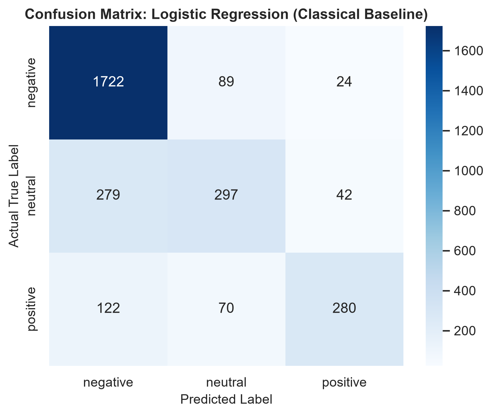
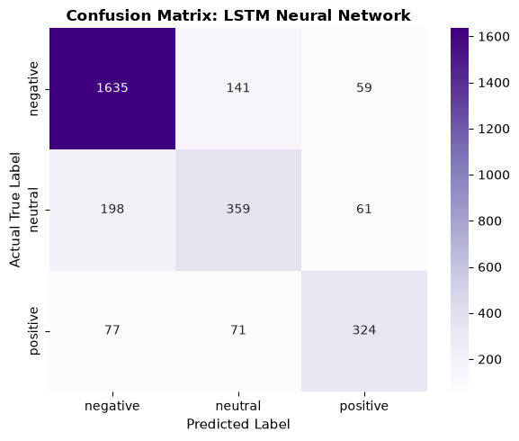
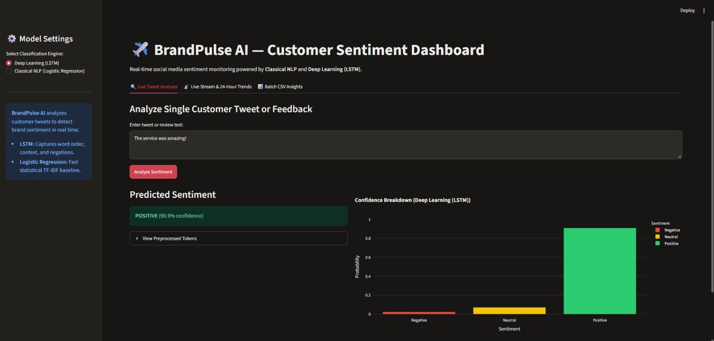
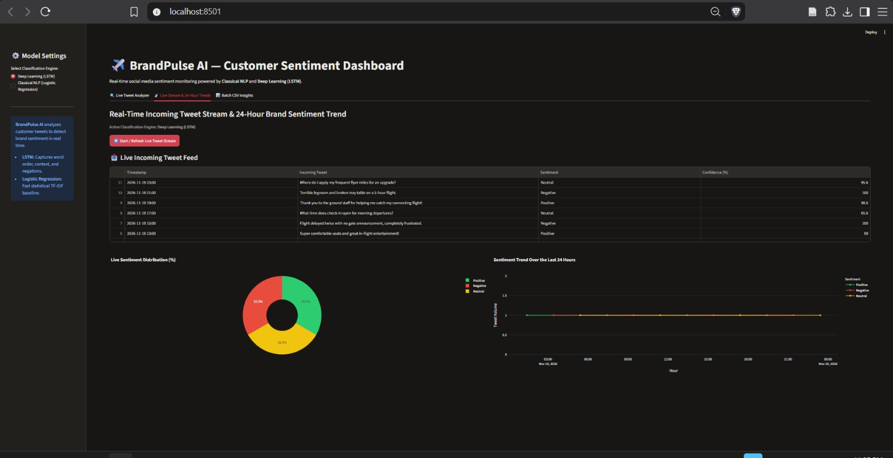

# BrandPulse AI — Real-Time Brand Sentiment & Reputation Monitor

BrandPulse AI is an end-to-end NLP and Deep Learning sentiment analysis system built to classify brand tweets into **Positive**, **Neutral**, and **Negative** categories, comparing a classical **TF-IDF + Logistic Regression** baseline against a **Bidirectional LSTM** neural network[cite: 2].

---

## 1. Model Performance Comparison (20% Held-Out Test Split)

Both models were evaluated strictly on the **exact same unseen 20% stratified test split** (`random_state=42`) to prevent data leakage and ensure a fair comparison.

| Model Architecture | Accuracy | Precision (Weighted) | Recall (Weighted) | F1-Score (Weighted) |
| :--- | :---: | :---: | :---: | :---: |
| **Classical NLP (TF-IDF + Logistic Regression)** | **78.60%** | **77.71%** | **78.60%** | **77.32%** |
| **Deep Learning (Bidirectional LSTM + Class Weights)** | **78.70%** | **77.91%** | **78.70%** | **78.15%** |

> **Key Takeaway:** While both models achieve nearly identical overall accuracy (~78.6%–78.7%), the **Bidirectional LSTM** achieves higher **Weighted Precision (77.91%)** and **Weighted F1-Score (78.15%)**, showing stronger class-balanced performance across minority classes (`Neutral` and `Positive`) without collapsing into majority-class (`Negative`) predictions[cite: 14].

---

## 2. Confusion Matrices (Held-Out Test Set)

| Classical NLP: TF-IDF + Logistic Regression | Deep Learning: Bidirectional LSTM |
| :---: | :---: |
|  |  |

---

## 3. Qualitative Evaluation: 10 Random Held-Out Test Samples

To verify real-world prediction behavior beyond aggregate metrics, 10 unseen tweets were sampled randomly from `X_test` (`random_state=42`) and compared against ground-truth labels:

| # | Held-Out Test Tweet (Cleaned) | Actual Ground Truth | Logistic Regression | BiLSTM Prediction |
| :-: | :--- | :---: | :---: | :---: |
| 1 | `manage place family plain none sitting next on...` | Negative | Negative | Negative |
| 2 | `get bumped pm birmingham delayed pilot schedul...` | Negative | Negative | Negative |
| 3 | `deal` | Neutral | Neutral | Neutral |
| 4 | `thnx` | Positive | Positive | Neutral |
| 5 | `thanksseat made year old broken tv flightsyear...` | Negative | Negative | Negative |
| 6 | `gt dfw might want clear ice plane landing` | Neutral | Neutral | Neutral |
| 7 | `customer service` | Negative | Negative | Negative |
| 8 | `huge problem someone whose ticket cancelled fl...` | Negative | Negative | Negative |
| 9 | `weve delayed delayed palm beach need head west...` | Negative | Negative | Negative |
| 10 | `yes service suck gate agent pushed passenger ...` | Negative | Negative | Negative |

### Custom & Sarcasm Inference Verification
- `"The service was amazing!"` $\rightarrow$ **Positive** (Both models)[cite: 3, 16]
- `"I waited 4 hours just to get a cold burger."` $\rightarrow$ **Negative** (Both models)[cite: 3, 16]
- `"Oh great, another 3-hour flight delay and lost baggage, just what I needed!"` $\rightarrow$ **Negative** (Both models)[cite: 16]
- `"Love sitting on the tarmac for two hours with zero updates from the crew."` $\rightarrow$ **Negative** (Both models)[cite: 16]

---

## 4. Error Analysis & Architectural Trade-Offs

- **Interpretability vs. Sequential Context:** TF-IDF + Logistic Regression is fast, lightweight, and directly interpretable via word feature weights, excelling on tweets with explicit sentiment keywords (`"thnx"`, `"delayed"`, `"broken"`). However, bag-of-words TF-IDF treats words independently and struggles with word order and negation. The **Bidirectional LSTM** reads sequences both forward and backward, capturing contextual phrasing and multi-word expressions (as reflected in its higher F1-score of **78.15%** vs. **77.32%**)[cite: 14].
- **Handling Class Imbalance & Sarcasm:** Because airline tweet datasets are heavily skewed toward Negative tweets, balanced `class_weight` was applied during BiLSTM training to prevent majority-class collapse and preserve recall on Neutral and Positive tweets. In rows #5 (`"thanksseat made year old broken tv..."`) and #10 (`"yes service suck gate agent..."`), both models successfully classified the tweets as **Negative** despite opening with positive-sounding words (`"thanks"`, `"yes"`)[cite: 16]. However, subtle sarcasm containing purely upbeat superlatives (e.g., `"Great job losing my luggage again, best airline ever"`) can still confuse classifiers when positive keyword weights outweigh negative context[cite: 8].

---

## 5. Streamlit Dashboard Preview

### Single Tweet Analyzer & Confidence Breakdown


### Live Tweet Stream, Sentiment Pie Chart & 24-Hour Trend Line


---

## 6. How to Run Locally

```bash
pip install -r requirements.txt
streamlit run app.py
